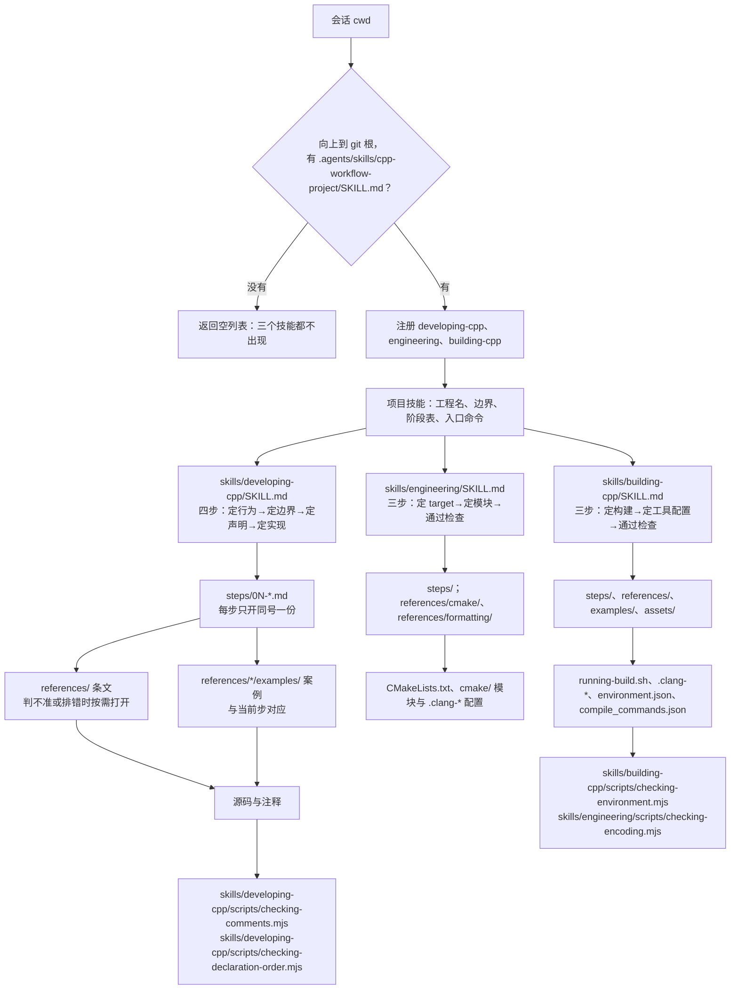

# 技能架构

本包在已经声明 C++ 工作流的仓库里注册三个技能：`developing-cpp` 管源码四步，`engineering` 管 target、CMake 模块与排版工具，`building-cpp` 管构建宿主、工具配置与通过检查。三者共享同一道前置：从会话 cwd 向上到 git 根，存在 `.agents/skills/cpp-workflow-project/SKILL.md`。目录与逐文件清单以 [module-layout.md](module-layout.md) 为准；本页解释分层、加载顺序、文件放在哪一份，以及维护本包时的写作约定。

## 数据流

三个技能同时出现时先开 `developing-cpp`；只改 CMake 时先开 `engineering`，落定后只到 `building-cpp` 的通过检查。`.qmd`、仓库 README 与 Python 不归本包。

## 共同布局

三个技能只共用一套布局：

- 每个技能是 `SKILL.md + steps/ + references/`；可执行片段放 `scripts/`，可复制样例放 `examples/` 或 `assets/`，编辑器接线放 `steps/`。
- 目录名不加数字；步骤文件用两位数字前缀，表示先后顺序；同一主题的条文按两位数字排阅读顺序，案例按种类命名，不加数字。
- 只有还会继续长大的主题才建子目录；`examples/` 与 `glossary/` 内不再建目录。
- 一份文件只讲一个主题：规则文件不超过 240 行，案例不超过 320 行；超长就拆主题，不堆长段。
- 同一事实只在一份文件展开，旧路径不保留转述页；跨技能需要时用相对路径直接指过去。

## 三个技能的四类改动

四类改动是入口，不是第二份规则：每个技能在 `SKILL.md` 里把内容、结构、版式、措辞四行落到具体步骤文件，正文只保留加载顺序。

- `skills/developing-cpp/SKILL.md`：内容与结构先到 `steps/01-behavior.md`、`steps/02-boundary.md`，声明与实现再到 `steps/03-declaration.md`、`steps/04-implementation.md`；注释事实在 `references/comments/01-comment-rules.md`（写什么）与 `02-style.md`（结构、版式、措辞），异常事实在 `references/exceptions/01-exception-rules.md`，规则冲突在 `skills/shared/rule-priority.md`。
- `skills/engineering/SKILL.md`：target、模块与检查分别到 `steps/01-targets.md`、`steps/02-modules.md`、`steps/03-check.md`；排版工具从入口表直接开 `references/formatting/` 的一份。
- `skills/building-cpp/SKILL.md`：构建、工具配置与通过检查分别到 `steps/01-build.md`、`steps/02-tooling.md`、`steps/03-check.md`。

## 为什么有 shared/

三个技能读取的公共事实（命名、注释、异常、术语表、标准档）仍放在 `developing-cpp` 的 `references/` 下，或放在 `engineering` 的 `references/cmake/standards/` 里，由另一个技能用相对路径点名；事实不复制到 `shared/`。

`skills/shared/` 只放三技能共用的操作模型、规则优先级与加载预算：`operations.md`、`rule-priority.md`、`budget.md`。三份 `SKILL.md` 只在「三种操作」「规则冲突」「加载预算」处点名，不把它当默认读物；加载仍受「一次只开一份」约束。三份 `SKILL.md` 与 `shared/` 同包安装；只复制一个技能会断链。

## 四层加载

| 层 | 职责 | 何时加载 |
| --- | --- | --- |
| 常驻元数据 | 三个技能的 `name` 与 `description`；模型侧目录只读这两项，`metadata` 随包发布但不渲染 | 会话目录常驻；正文不加载 |
| 技能正文 | `skills/<name>/SKILL.md` 的适用场景、操作、步骤、入口表与完成判据 | 技能被选中时 |
| 步骤 | `steps/0N-*.md` 的当前步骤流程 | 进入该步时只开同号一份 |
| 条文与案例 | `references/` 的全部 md；`engineering` 另有 `references/cmake/assets/` | 入口表或步骤点名时；判不准、规则冲突或排错时按需 |

约束：正文只做路由与加载顺序，不抄条文；步骤每步只打开同号一份；一份规则不超过 240 行，一份案例不超过 320 行；三技能共用的操作模型、优先级与加载预算见 `skills/shared/`。

例：判不准下标该用 `size_t` 还是 `int` 时，才打开 `references/language/value-types/09-subscript.md`；只在函数体里改一处逻辑时，不打开整组语言条文。

## 失败与降级

注册表把技能当可选能力：provider 抛错或返回 `{ candidates, complete: false }` 时归入不完整观测，下一轮重试，不缓存。失败要按层分开看，不要混成一句：

| 层 | 行为 | 代码位置 |
| --- | --- | --- |
| 文件 frontmatter | `name` 与目录不同、`description` 为空、名字不在白名单、块标量不支持：静默跳过，`complete` 仍为 true | `src/index.ts:167-172` |
| 候选对象 | `description` 不是字符串或为空：`dsh-skill` 抛错，整次发现失败 | `dsh-skill:455-456` |
| 目录/文件读取 | `skills/` 读不出：`{ candidates: [], complete: false }`；单份 `SKILL.md` 读不出：保留其余候选，`complete: false` | `src/index.ts:203-215` |

本包自身不抛错：门禁不通过、没传 `cwd` 等确定性空目录返回 `[]`（完整观察）；`skills/` 或某份 `SKILL.md` 读不出来时返回 `{ candidates, complete: false }`，有可用候选时保留其余候选，宿主不会缓存这次结果。`get()` 失败一律返回 `undefined`。

- cwd 没有工作流门禁、没传 `cwd`、收到已中止的 `AbortSignal`：`list()` 返回 `[]`；abort 时宿主还会在调用前后抛出 `AbortError`，用户侧看到的仍是中止。
- `skills/` 读不出来：`list()` 返回 `{ candidates: [], complete: false }`；某份 `SKILL.md` 读不出来：其余候选照常返回，观察标为 `complete: false`。这两种情况宿主都不会缓存，下一轮重试。
- `get()` 的候选不属于本包、名字不在三个之内、locator 解析后越出 `skills/`、目录名或 frontmatter 的 `name` 与候选名不符：返回 `undefined`。
- 带 cwd 加载时重新核对门禁；门禁在会话中途消失后，旧候选不再加载。

同名技能按 rank、provider 注册顺序、本地顺序裁决，本包的 rank 与项目内同名冲突见 [plugin-boundaries.md](plugin-boundaries.md)。

## 目录职责

| 路径 | 职责 |
| --- | --- |
| `skills/developing-cpp/SKILL.md` | 源码四步与 `references/` 的入口 |
| `skills/engineering/SKILL.md` | CMake 三步（`steps/`）与 `references/cmake/`、`references/formatting/` 的入口 |
| `skills/building-cpp/SKILL.md` | 构建三步、编辑器接线、环境脚本与工程模板的入口 |
| `docs/module-layout.md` | 目录树与逐文件清单，结构检查的覆盖依据 |
| `docs/triggering.md` | 触发矩阵与反例 |
| `docs/plugin-storage.md` | 运行时磁盘与缓存边界、守卫与 dsh-ops 对照 |
| `templates/cpp-workflow-project/` | 项目技能模板，不注册为技能 |
| `scripts/` | 结构检查、客户端构建、工作流检查与标准矩阵 |
| `src/`、`locale/` | 插件运行时与包元数据；插件页文案在 `src/client/text.js` |

## 写作约定

维护本包时按同一套写法改，结构检查只保证形状，内容质量靠这几条：

- 一份文件只讲一个主题，标题最多到三级；能用列表或表格就不写长段，一段只讲一件事。
- 操作、域、步骤三个词固定：操作只有写作、改写、润色；域只有内容、结构、版式、措辞；步骤一律写「第 N 步」。
- 代码路径、命令、类型名一律用反引号；跨技能引用写相对路径，不复述条文。
- 规则文件不超过 240 行，案例不超过 320 行；超长先拆主题，不删事实。
- 引用条文或案例时带上条件：写「写回滚逻辑时读 …」「出现链接失败时跳过 …」，读者不必猜该不该打开。
- 改完条文把 `skills/developing-cpp/scripts/checking-comments.mjs` 与 `checking-declaration-order.mjs` 跑在示例工程上；条文与检查器要同时过关，示例与正文不得出现检查器会报的写法。
- 三份 `SKILL.md` 保持同一副骨架：适用场景、三种操作、步骤、入口表、加载预算、四类改动、完成判据；新增小节先改 `docs/module-layout.md` 与结构检查，再改正文。
- 面向读者的句子用中文，术语与 API 名保留原文；一句话能说清的不写成两句。
- 源码、脚本、测试与配置的注释统一写中文，命令、路径与 API 名保留原文；只解释意图、边界与取舍，不复述代码。

## 检查

`npm test` 先跑客户端与源一致性检查，再构建 `lib/`，然后跑 `scripts/checking-skill-links.mjs`、编码检查、工作流检查与单元测试；结构检查要求本页存在、mermaid 数据流块存在且含 flowchart 关键字、三个技能名与三个检查器名（`checking-comments.mjs`、`checking-environment.mjs`、`checking-declaration-order.mjs`）齐全，并要求 `docs/module-layout.md` 的树按文件名覆盖每个技能 Markdown/脚本文件；目录层级与放置位置以该页为准。新增或移动文件时先改 module-layout 的树，再改结构检查，最后跑 `npm test`。
