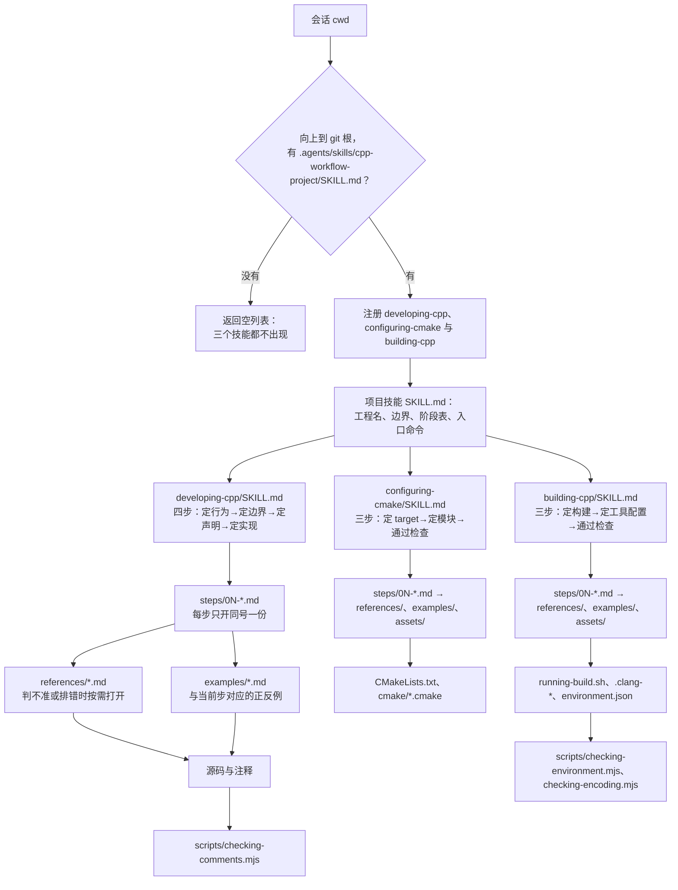

# 技能架构

这个包有三个技能和五份维护说明，没有共享层，也没有按域拆分的工具。架构只回答三个问题：会话里谁先出现、技能内部按什么顺序加载、同一事实写在哪一份文件里。

## 数据流

门禁只认项目技能标记，所以图从 cwd 开始、到 git 根结束。三个技能在门禁之后是并列的：源码走 developing-cpp，CMake 契约走 configuring-cmake，构建与工具链走 building-cpp。一次改动同时碰到源码和 CMake 时，先开 developing-cpp 定行为与边界，再用 configuring-cmake 写 target，最后到 building-cpp 跑检查；只改 CMake 时从 configuring-cmake 开始，完成前落到 building-cpp 的通过检查。

## 三个技能的四类改动

`steps/` 是做法，`references/` 是事实，`examples/` 是例子，`docs/` 是原因；这是 Diátaxis 的文档轴。四类改动是操作内部的域，只决定这次改的是哪一层，不新增目录，也不改加载顺序。三个技能各有一张同序表，权威条文在 `skills/developing-cpp/SKILL.md`、`skills/configuring-cmake/SKILL.md`、`skills/building-cpp/SKILL.md` 的「四类改动」；本页不复制，避免同一事实出现两份。

域只决定这一层做什么，不新增加载层：每域仍落到现有的步骤文件与条文，`references/` 不按域建子目录，避免同一事实出现两份路径。写作域先落定行为与边界，布局与排版只改变形状，润色只改措辞。`comments.md` 按四类改动分节：写作定构造后置条件与成员事实，布局定注释位置与行尾形态，排版定符号、宽度与标签，润色删复述、统一句式；`scripts/checking-comments.mjs` 逐条检查。`exceptions.md` 的「消息」节定 `what()` 的来源、条件、实际值与限度，语言由项目约定，消息不在抛出点做本地化。同一处命中多条规则时，按 `priority.md` 的五级次序判：行为与契约 > 结构 > 清晰 > 一致 > 形式。

## 为什么没有 shared/

三个技能分开加载：源码工作不进构建文件的上下文，CMake 契约不进源码条文，构建与工具链也不进 CMake 写法。真正被三方同时需要的内容只有 C++ 标准档位：语言设施、工具映射与降档在 `skills/building-cpp/references/standards/`，CMake 两层声明在 `skills/configuring-cmake/references/cxx-standard.md`，源码侧需要时用链接指向那里，不复制正文。

再加一层 `shared/` 会多出一条第三条加载路径：加载时机、结构检查和链接检查都要为它单独定义，而它省下的只是几行交叉引用。当前规模下，直接把入口写进三个 `SKILL.md` 更短，也更容易在评审时查清「这句话只有一份」。

## 四层加载

| 层 | 文件 | 何时进上下文 | 预算 |
| --- | --- | --- | --- |
| 常驻元数据 | 三个 `SKILL.md` 的 frontmatter | 每次技能列表查询 | 每个约 100 token |
| 技能正文 | `SKILL.md` 的 H2 四节 | 技能被选中后整篇载入 | 每个不超过 150 行 |
| 步骤 | `steps/0N-*.md` | 走到第 N 步时只开同号一份 | 每份不超过 60 行 |
| 条文与案例 | `references/`、`examples/`、`assets/` | 判不准、排错或步骤明确指向时 | 每份不超过 120 行 |

`SKILL.md` 的「步骤」表是唯一的路由表：步号、名称、文件、一句话。`references/` 不自动加载，必须由步骤或 `SKILL.md` 带条件句指向，例如「判不准坐标类型时打开 `references/types.md` 的区间与半开区间一节」；只写「详见 references/」不算。

单次激活的上限是「一个 `SKILL.md` + 一个步骤文件 + 该步点名的一份条文或案例」；同号案例留到下一次激活，标准档只开项目技能声明的那一档。检查命令退出码为 0 后在同一轮结束 goal，不继续走没有失败的步骤。

## 文件职责

| 路径 | 唯一职责 |
| --- | --- |
| `skills/developing-cpp/SKILL.md` | 触发描述、适用边界、四步路由、完成判据 |
| `skills/developing-cpp/steps/01-behavior.md`、`02-boundary.md`、`03-declaration.md`、`04-implementation.md` | 单步操作与退出条件 |
| `skills/developing-cpp/examples/comments-declaration.md`、`comments-implementation.md`、`exceptions.md`、`naming.md`、`structure.md` | 对应步骤的正反例 |
| `skills/developing-cpp/references/comments.md` | 注释四节（写作、布局、排版、润色）与长度预算 |
| `skills/developing-cpp/references/priority.md` | 规则冲突时的五级次序与常见冲突 |
| `skills/developing-cpp/references/file-template.md` | 文件槽位、守卫、扩展名 |
| `skills/developing-cpp/references/google-cpp-style.md` | Google 基线与本仓偏差点 |
| `skills/developing-cpp/references/naming.md`、`types.md`、`language.md`、`exceptions.md`、`declaration-order.md`、`layout.md`、`performance.md`、`standard-library.md`、`project-design.md`、`glossary.md` | 各自主题的完整条文；术语只在 `glossary.md` 定义 |
| `skills/developing-cpp/scripts/checking-comments.mjs` | 只读注释审计，退出码 0/1/2 |
| `skills/configuring-cmake/SKILL.md` | 触发描述、CMake 边界、三步路由、完成判据 |
| `skills/configuring-cmake/steps/01-targets.md`、`02-modules.md`、`03-check.md` | 单步操作与退出条件 |
| `skills/configuring-cmake/examples/cmake.md` | target、标准、GLOB 与 RPATH 的正反例 |
| `skills/configuring-cmake/references/cmake.md`、`cxx-standard.md`、`modules.md` | CMake 形状、注释与排版、C++ 标准映射、函数与模块契约 |
| `skills/configuring-cmake/assets/cmake/` | 编译设置与链接设置的可复制函数，按性质聚合 |
| `skills/building-cpp/SKILL.md` | 触发描述、构建边界、三步路由、完成判据 |
| `skills/building-cpp/steps/01-build.md`、`02-tooling.md`、`03-check.md` | 单步操作与退出条件 |
| `skills/building-cpp/examples/environment.md`、`tooling.md` | 对应步骤的正反例 |
| `skills/building-cpp/references/linking.md`、`static-analysis.md`、`encoding.md`、`environment.md`、`build-script.md`、`testing.md` | 链接、工具、编码、环境轴、入口脚本与测试 |
| `skills/building-cpp/references/standards/` | 五档 `README.md` 与 `cmake-snippet.cmake`：设施、工具、降档与验证 |
| `skills/building-cpp/scripts/checking-environment.mjs`、`checking-encoding.mjs` | 环境声明、构建产物 `compile_commands.json` 与编码的行检查 |
| `skills/building-cpp/assets/` | 工具配置、四套工程模板；只复制，不注册为技能 |
| `templates/cpp-workflow-project/` | 项目技能模板：门禁标记、环境声明、阶段表 |
| `scripts/checking-skill-links.mjs` | 包元数据、三技能结构、链接、触发矩阵与结构检查 |
| `docs/architecture.md` | 本页：分层、数据流与文件职责 |
| `docs/plugin-flow.md` | 门禁与分流的维护说明 |
| `docs/triggering.md` | 触发矩阵与描述维护规则 |
| `docs/plugin-layout.md` | 目录与进包白名单 |
| `docs/versioning.md` | 版本号与发布顺序 |

同一事实只留一份权威：命名总则在 `references/naming.md`，注释在 `references/comments.md`，术语在 `references/glossary.md`，标准档位在 `references/standards/`。步骤文件只写「这一步做什么、何时退出」，条文细节一律指向 references；三个技能不互相复制正文，只互相指向对方的入口。

## 检查

`npm test` 依次跑构建、`scripts/checking-skill-links.mjs`、编码检查与 `tests/*.test.mjs`。结构检查覆盖本图里的每一层：SKILL.md 的 H2 与步骤表、steps 文件号与 H1、references/examples 非空、Markdown 链接可解析、触发矩阵关键词齐全。新增或改名文件时先改本页的文件职责表，再改结构检查，最后改 `docs/plugin-layout.md` 的目录树。
