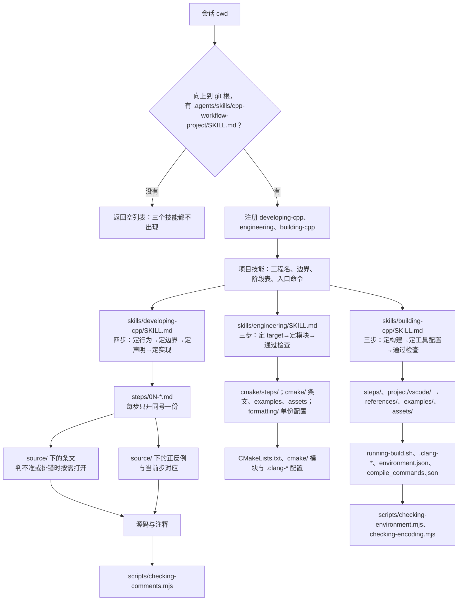

# 技能架构

本包在已经声明 C++ 工作流的仓库里注册三个技能：`developing-cpp` 管源码与注释的四步，`engineering` 管 target、CMake 模块与排版工具配置，`building-cpp` 管构建宿主、工具配置与通过检查。三者共享同一道前置：从会话 cwd 向上到 git 根，存在 `.agents/skills/cpp-workflow-project/SKILL.md`。目录与文件以 [module-layout.md](module-layout.md) 为准；本页只解释分层、加载顺序与同一事实放在哪一份文件。

## 数据流

三个技能同时出现时先开 `developing-cpp`；只改 CMake 时先开 `engineering`，落定后只到 `building-cpp` 的通过检查。`.qmd`、仓库 README 与 Python 不归本包。

## 三个技能的四类改动

四类改动是入口，不是第二份规则：每个技能在 `SKILL.md` 里把内容、结构、版式、措辞四行落到具体步骤文件，正文只保留加载顺序。

- `skills/developing-cpp/SKILL.md`：内容与结构先到 `steps/01-behavior.md`、`steps/02-boundary.md`，声明与实现再到 `steps/03-declaration.md`、`steps/04-implementation.md`；注释事实在 `source/07-comments/01-comment-rules.md`，异常事实在 `source/08-exceptions/01-throw-rules.md`，规则冲突在 `source/01-editing/02-rule-priority.md`。
- `skills/engineering/SKILL.md`：target、模块与检查分别到 `cmake/steps/01-targets.md`、`cmake/steps/02-modules.md`、`cmake/steps/03-check.md`；排版工具从入口表直接开 `formatting/` 的一份。
- `skills/building-cpp/SKILL.md`：构建、工具配置与通过检查分别到 `steps/01-build.md`、`steps/02-tooling.md`、`steps/03-check.md`。

## 为什么没有 shared/

三个技能读取的公共事实（命名、注释、异常、术语表、标准档）都放在 `developing-cpp` 的 `source/` 下，或放在 `engineering` 的 `cmake/03-standard/standards/` 里，由另一个技能用相对路径点名。没有 `shared/` 是刻意的：共享目录一旦存在，三份 `SKILL.md` 都会把它当默认读物，加载预算与「每步只打开同号」都会失效。同一个事实只写一份；确实需要跨技能引用时，用相对路径直接指过去，不复制第二份。`source/01-editing/01-edit-operations.md` 是唯一一份跨技能变更模型的正文。

## 四层加载

| 层 | 说明 | 约束 |
| --- | --- | --- |
| 常驻元数据 | 三个技能的 `name`、`description`、`metadata.short-description` | description 同时写做什么、何时用、不用于什么 |
| 技能正文 | `skills/<name>/SKILL.md` | 只做路由与加载顺序，不抄条文 |
| 步骤 | `steps/0N-*.md` | 每步只打开同号一份，单步不把全部条文列出来 |
| 条文与案例 | `source/` 的全部 md；`engineering` 是 `cmake/` 与 `formatting/`；`building-cpp` 是 `references/` 与 `examples/` | 判不准或排错才打开；一份规则不超过 240 行，一份案例不超过 320 行 |

例：判不准下标该用 `size_t` 还是 `int` 时，才打开 `source/05-language/02-value-types/09-subscript.md`；只在函数体里改一处逻辑时，不打开整组语言条文。

## 目录职责

| 路径 | 职责 |
| --- | --- |
| `skills/developing-cpp/SKILL.md` | 源码四步与 `source/` 的入口 |
| `skills/engineering/SKILL.md` | CMake 三步（`cmake/steps/`）与 `cmake/`、`formatting/` 的入口 |
| `skills/building-cpp/SKILL.md` | 构建三步、编辑器接线、环境脚本与工程模板的入口 |
| `docs/module-layout.md` | 目录树与逐文件清单，结构检查的覆盖依据 |
| `docs/triggering.md` | 触发矩阵与反例 |
| `templates/cpp-workflow-project/` | 项目技能模板，不注册为技能 |
| `scripts/` | 结构检查、客户端构建、工作流检查与标准矩阵 |
| `src/`、`locale/` | 插件运行时与文案 |

## 检查

`npm test` 先构建 `lib/`，再跑客户端检查、`scripts/checking-skill-links.mjs`、编码检查、工作流检查与单元测试；结构检查要求本页存在、mermaid 数据流可解析、三个技能名与三个检查器名齐全，并要求 `docs/module-layout.md` 的树覆盖每个技能文件。新增或移动文件时先改 module-layout 的树，再改结构检查，最后跑 `npm test`。
