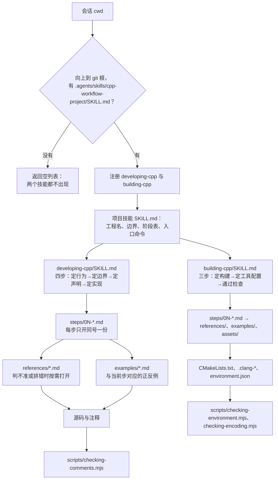

# 技能架构

这个包只有两个技能和五份维护说明，没有共享层，也没有按域拆分的工具。架构只回答三个问题：会话里谁先出现、技能内部按什么顺序加载、同一事实写在哪一份文件里。

## 数据流

门禁只认项目技能标记，所以图从 cwd 开始、到 git 根结束。两个技能在门禁之后是并列的：源码走 developing-cpp，构建文件走 building-cpp；一次改动同时碰到两边时，先开 developing-cpp，完成前必须落到 building-cpp 的定构建与通过检查。

## 四个写作域

`developing-cpp` 的四步按「写什么、放哪里、怎么排、怎么润」四类改动重排入口；这张表是 `SKILL.md`「四类改动」小节的维护镜像，两处必须同改，`scripts/checking-skill-links.mjs` 会比对两处的域名、顺序与权威条文。

| 域 | 内容 | 入口 | 权威条文 |
| --- | --- | --- | --- |
| 写作 | 可观察行为、库与程序的边界、声明与实现 | 第 1 步 | `steps/01-behavior.md`、`02-boundary.md`、`references/project-design.md` |
| 布局 | 文件槽位与命名、头文件拆合、声明顺序、测试 target | 第 3 步 | `references/file-template.md`、`declaration-order.md` |
| 排版 | 缩进、行宽、包含顺序、格式基线与偏差点 | 第 3 步或 `building-cpp` 的定工具配置 | `references/google-cpp-style.md`、`layout.md` |
| 润色 | 命名措辞、注释四层与长度预算 | 第 3–4 步 | `references/naming.md`、`comments.md` |

域只决定入口，不新增加载层：每域仍落到现有的步骤文件与条文，`references/` 不按域建子目录，避免同一事实出现两份路径。写作域先落定行为与边界，布局与排版只改变形状，润色只改措辞。`comments.md` 的类型注释判据——只写本类型契约、不写跨类分工、不复述类型系统、不写未来用法——是润色域的硬规则，`scripts/checking-comments.mjs` 逐条检查。

## 为什么没有 shared/

两个技能分开加载：源码工作不进构建文件的上下文，构建工作也不进源码条文。真正被两边同时需要的内容只有 C++ 标准档位，它放在 `skills/building-cpp/references/standards/`，源码侧需要时用链接指向那里，不复制正文。

再加一层 `shared/` 会多出一条第三条加载路径：加载时机、结构检查和链接检查都要为它单独定义，而它省下的只是几行交叉引用。当前规模下，直接把入口写进两个 `SKILL.md` 更短，也更容易在评审时查清「这句话只有一份」。

## 四层加载

| 层 | 文件 | 何时进上下文 | 预算 |
| --- | --- | --- | --- |
| 常驻元数据 | 两个 `SKILL.md` 的 frontmatter | 每次技能列表查询 | 每个约 100 token |
| 技能正文 | `SKILL.md` 的 H2 四节 | 技能被选中后整篇载入 | 每个不超过 150 行 |
| 步骤 | `steps/0N-*.md` | 走到第 N 步时只开同号一份 | 每份不超过 60 行 |
| 条文与案例 | `references/`、`examples/`、`assets/` | 判不准、排错或步骤明确指向时 | 每份不超过 120 行 |

`SKILL.md` 的「步骤」表是唯一的路由表：步号、名称、文件、一句话。`references/` 不自动加载，必须由步骤或 `SKILL.md` 带条件句指向，例如「判不准坐标类型时打开 `references/types.md` 的区间与半开区间一节」；只写「详见 references/」不算。

## 文件职责

| 路径 | 唯一职责 |
| --- | --- |
| `skills/developing-cpp/SKILL.md` | 触发描述、适用边界、四步路由、完成判据 |
| `skills/developing-cpp/steps/01-behavior.md`、`02-boundary.md`、`03-declaration.md`、`04-implementation.md` | 单步操作与退出条件 |
| `skills/developing-cpp/examples/comments.md`、`exceptions.md`、`naming.md`、`structure.md` | 对应步骤的正反例 |
| `skills/developing-cpp/references/comments.md` | 注释四层规范与长度预算 |
| `skills/developing-cpp/references/file-template.md` | 文件槽位、守卫、扩展名 |
| `skills/developing-cpp/references/google-cpp-style.md` | Google 基线与本仓偏差点 |
| `skills/developing-cpp/references/naming.md`、`types.md`、`language.md`、`exceptions.md`、`declaration-order.md`、`layout.md`、`performance.md`、`standard-library.md`、`project-design.md`、`glossary.md` | 各自主题的完整条文；术语只在 `glossary.md` 定义 |
| `skills/developing-cpp/scripts/checking-comments.mjs` | 只读注释审计，退出码 0/1/2 |
| `skills/building-cpp/SKILL.md` | 触发描述、构建边界、三步路由、完成判据 |
| `skills/building-cpp/steps/01-build.md`、`02-tooling.md`、`03-check.md` | 单步操作与退出条件 |
| `skills/building-cpp/examples/cmake.md`、`environment.md`、`tooling.md` | 对应步骤的正反例 |
| `skills/building-cpp/references/cmake.md`、`linking.md`、`static-analysis.md`、`encoding.md`、`environment.md`、`build-script.md` | CMake target、链接、工具、编码、环境轴与入口脚本 |
| `skills/building-cpp/references/standards/` | 五档 `README.md` 与 `cmake-snippet.cmake`：设施、工具、降档与验证 |
| `skills/building-cpp/scripts/checking-environment.mjs`、`checking-encoding.mjs` | 环境声明、构建产物 `compile_commands.json` 与编码的行检查 |
| `skills/building-cpp/assets/` | CMake 片段、工具配置、四套工程模板；只复制，不注册为技能 |
| `templates/cpp-workflow-project/` | 项目技能模板：门禁标记、环境声明、阶段表 |
| `scripts/checking-skill-links.mjs` | 包元数据、两技能结构、链接、触发矩阵与结构检查 |
| `docs/architecture.md` | 本页：分层、数据流与文件职责 |
| `docs/plugin-flow.md` | 门禁与分流的维护说明 |
| `docs/triggering.md` | 触发矩阵与描述维护规则 |
| `docs/plugin-layout.md` | 目录与进包白名单 |
| `docs/versioning.md` | 版本号与发布顺序 |

同一事实只留一份权威：命名总则在 `references/naming.md`，注释在 `references/comments.md`，术语在 `references/glossary.md`，标准档位在 `references/standards/`。步骤文件只写「这一步做什么、何时退出」，条文细节一律指向 references；两个技能不互相复制正文，只互相指向对方的入口。

## 检查

`npm test` 依次跑构建、`scripts/checking-skill-links.mjs`、编码检查与 `tests/*.test.mjs`。结构检查覆盖本图里的每一层：SKILL.md 的 H2 与步骤表、steps 文件号与 H1、references/examples 非空、Markdown 链接可解析、触发矩阵关键词齐全。新增或改名文件时先改本页的文件职责表，再改结构检查，最后改 `docs/plugin-layout.md` 的目录树。
